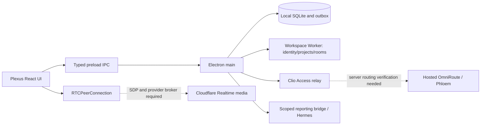

# Plexus feature review and Phloem/calling map

Review date: 2026-10-23. Source worktree package version: 0.7.13.
This is a source inventory and local regression receipt. Installed app behavior,
server deployment parity and authenticated two-person calling remain separate acceptance gates.

## How the application fits together

Plexus is the employee-facing desktop workspace. React renders work records,
Clio and co-working. The preload exposes typed IPC. Electron main owns local
SQLite, OS integration, identity and network requests; it keeps privileged
credentials outside the renderer. The Workspace Worker resolves member authority
and stores canonical project and collaboration state. Clio is the assistant
experience inside Plexus; OmniRoute provides its model-routing service. Phloem is
the hosted routing surface named in this task. Audio/video collaboration uses a
separate WebRTC/SFU transport and the Workspace Worker application API.

The dashed routing link is an intended mapping that needs a server deployment
receipt. A reachable Phloem URL does not establish that Clio's relay points at it.
The dashed media link was incomplete in the inspected baseline contract; coordinated local Worker/client candidates now implement its negotiation path, pending deployment and live acceptance. Neither model
routing nor a successful room join supplies a media connection by itself.

## Feature inventory and source ownership

These are implemented surfaces/contracts, not a claim that every external
integration is currently operational for the signed-in user.

| Feature | What the user can understand/do | Primary source | External boundary |
| --- | --- | --- | --- |
| Sign-in and onboarding | Establish member identity, permissions and workspace setup | `Login.tsx`, `Onboarding.tsx`, `main/teamforge.ts` | Cloudflare Access and Worker session |
| Focus timer and recovery | Track work, pause/resume and recover an interrupted session | `Timer.tsx`, `main/timer-session.ts`, `main/idle.ts` | Local persistence; later Worker sync |
| Work ledger and evidence | Review time entries, charts and proof coverage | `TimeEntryList.tsx`, `TimeChart.tsx`, `main/evidence.ts`, `main/proof-report.ts` | Evidence identity and sync receipts |
| Canonical projects | Select verified projects and associate GitHub repositories | `ProjectManager.tsx`, `main/teamforge.ts`, `main/github-repository-binding-lock.ts` | Worker project authority and GitHub grants |
| Reports, reviews and growth | Inspect work summaries, periodic review and KPI signals | `Reports.tsx`, `GrowthOverviewPanel.tsx`, `main/review-cycle.ts`, `main/growth-overview.ts` | Worker summary and reporting delivery |
| Export | Prepare work data output | `ExportPanel.tsx` | Exported file contents/permissions |
| Backups and restore | List local backups and restore persisted work | `BackupPanel.tsx`, `main/backup.ts` | Local filesystem and restore confirmation |
| Clio conversation | Stream assistant responses with bounded work context and model selection | `AssistantPanel.tsx`, `main/assistant-runtime.ts`, `main/assistant-context.ts`, `main/assistant-omniroute.ts` | Authenticated relay and provider result |
| Assistant actions | Review/confirm/cancel write-capable tool intents | `AssistantActionConfirmModal.tsx`, `main/assistant-tools.ts`, `main/assistant-policy.ts`, `main/assistant-permissions.ts` | Action-specific authority and expiry |
| AI session activity | Discover/group local AI sessions; accept/dismiss work candidates | `AgentSessionsPanel.tsx`, `AgentActivityHub.tsx`, `main/agent-sessions.ts` | Local scanner provenance; accepting creates work data |
| Member reporting | Queue daily evidence, retry and hand off to Hermes | `main/assistant-daily.ts`, `main/thoughtseed-bridge.ts` | Bridge acknowledgement differs from final delivery |
| Co-working presence | See floor/lounge and focused project zones | `CoWorkingPanel.tsx`, `main/coworking-presence-controller.ts`, `main/coworking-presence.ts` | Authorized presence lifecycle and Worker readback |
| Audio, camera and screen controls | Request device access and publish/subscribe tracks in a project call | `renderer/lib/useRealtimeMedia.ts`, `renderer/lib/RealtimeSession.ts`, `coworking/DeviceControls.tsx`, `coworking/MediaDock.tsx`, `coworking/StudioStage.tsx` | SFU session/SDP negotiation and remote MediaStreams |
| Meeting closeout | Save manual notes, decisions/action items and linked work | `coworking/CoWorkingCloseoutModal.tsx`, `main/teamforge.ts` | Queued closeout is not downstream dispatch proof |
| Recording/transcription | Reserved/proposed recording contracts exist | `shared/types.ts`, `preload/preload.ts`, realtime contract | Main recording handlers and capture/storage path absent; not ready |
| Settings/profile | Manage preferences, identity and assistant settings | `Settings.tsx`, `PreferencesPanel.tsx`, `ProfileCard.tsx`, `IdentityPanel.tsx` | Per-member persistence and identity grants |
| Updates | Check, download and explicitly consent to installation/restart | `UpdatePrompt.tsx`, `main/updates.ts` | Signed/notarized published release plus installed proof |
| Administration/diagnostics | Inspect project/member operational evidence | `AdminDiagnosticsPanel.tsx`, `AdminProofCockpitPanel.tsx`, `AdminDemoPanel.tsx` | Admin authorization and diagnostic scope |
| Desktop integration | Tray, shortcuts, window modes, idle/device permissions | `main/tray.ts`, `main/shortcuts.ts`, `main/window-mode.ts`, `main/media-authorization.ts` | OS permissions and installed bundle |

Component names in this table are under `src/renderer/components/` unless a
`main/`, `preload/`, `shared/` or `renderer/lib/` prefix is shown; those prefixes
are relative to `src/`. Historical `teamforge` filenames are compatibility
implementation names. They do not create a second authority for project identity.

## A practical walkthrough

1. Sign in with your workspace identity and complete the OS permission checks.
2. Open Projects and choose a canonical project with verified repository access.
3. Start a focus session, describe the work, pause/resume as needed, and review its evidence in the work ledger.
4. Open Clio for a contextual assistant response. The desktop sends an authorized request to the Clio relay; the hosted relay candidate translates its selected lane to a Phloem combo.
5. Open Co-working, select a project room and join. Joining a project room establishes presence; it does not switch on your microphone or camera.
6. Use the microphone or camera control when ready. The client obtains a provider session, requests device capture, publishes its track through the authorized Worker and applies the returned SDP.
7. A teammate joining the same authorized room subscribes to each publication and completes the provider offer/answer exchange. Receiving a teammate does not automatically capture your devices.
8. Leave or end the call. The desktop stops local capture; the Worker candidate closes provider flows and records participant/track closure. Save meeting notes separately if needed.

Steps involving hosted Clio and media describe the coordinated candidate behavior. They remain pending deployment and live acceptance in this review.

## Clio to hosted Phloem mapping

| Layer | Source behavior | Required evidence before calling it working |
| --- | --- | --- |
| Plexus assistant UX | Context, prompts, tool intent confirmation and streamed replies | Signed-in request with real content and selected lane |
| Packaged origin | `assistant-omniroute.ts` bakes `https://clio-relay.thoughtseed.space`; arbitrary packaged overrides are rejected | Preserve the approved relay or make a separately reviewed origin migration |
| Model discovery | `assistant-model-catalog.ts` fetches authenticated `/v1/models` through `fetchOmniRouteWithAccess` | A current permitted lane catalog for this member |
| Model streaming | `assistant-omniroute.ts` constructs OpenAI-compatible model SDK requests with authenticated fetch | Content-bearing completed response, errors/cancellation and tool behavior |
| Access | `main/teamforge.ts` owns the Access fetch path and relay-origin restrictions | Valid member Access flow; no infrastructure keys in renderer |
| Hosted Phloem | Task target `https://omniroute.thoughtseed.space` | Canonical relay-to-Phloem upstream config and authenticated server receipt |
| Actual provider/model | Resolved backend may differ from requested lane | Upstream attribution for the completed request; lane name alone is insufficient |
| Calls | Worker realtime API plus Cloudflare provider transport | Independent two-client media proof; `/v1/models` does not negotiate a call |

Do not point media SDP, device streams or privileged Cloudflare credentials at
a model endpoint. Voice-to-Clio (speech input/output or realtime AI voice) is a
separate product integration; the current human collaboration media code does
not establish such a feature. A Phloem model catalog entry alone does not prove
speech, transcription or realtime voice capability.

## Calling findings and bounded repair

The source reconciliation in `REALTIME_WORKER_API_CONTRACT.md` identifies three
blocking server contracts: initial provider session creation expects SDP while
app join omits it; track handling records metadata rather than brokering
provider negotiation; renegotiation does not establish an implemented provider
round trip. A coordinated Worker candidate now implements session allocation without initial SDP,
track brokering and renegotiation in the existing route namespace. Its isolated
checkout is `../plexus-calling-worker-20261023` relative to this worktree.
Canonical deployed parity and authenticated calling still need verification.
The desktop changes consume that candidate contract; deploying only one side
will not complete calling.

The client previously returned track IDs and subscription counts when the
Worker recorded metadata without an SDP answer. It also swallowed SDP application
errors while returning publication success. That made UI state overstate media
readiness. The repaired `RealtimeSession` now:

- Requires a configured provider session before publishing media and refuses metadata-only publication as success.
- Publishes one matching media track with its transceiver mid and ICE-gathered typed offer; accepts a nonempty string answer or typed `{ type: 'answer', sdp }` and fails when the answer is absent, deferred or rejected.
- Subscribes one target per completed exchange with its matching media kind and application publication ID, applies the provider offer using the returned mid-to-publication mapping, creates an ICE-gathered answer and completes the authenticated Worker renegotiation route before counting subscriptions.
- Waits at most ten seconds for complete ICE gathering because the client has no separate trickle-candidate transport.
- Requires a provider track ID for successful local publication, closes a failed publication's metadata row, removes all associated senders and rolls back an outstanding offer.
- Counts subscribed targets only after the provider answer applies; deduplicates accepted subscriptions while waiting for `ontrack`.
- Serializes publish/subscribe/unpublish operations to avoid overlapping offers.
- Keeps temporarily muted remote streams mapped until `ended`, so resumable tracks stay identifiable.
- Prevents reinitialization and in-flight success after close; clears all senders and subscription maps on teardown.
- Lazily upgrades presence-only project membership to a provider media session before explicit capture or subscribing to an advertised remote publication. This does not capture a device on room join.
- Stops failed or delayed microphone/camera/screen capture after teardown and retains the owning session in screen-ended handlers.
- Surfaces actual peer connection state in project media health rather than equating provider configuration with connectivity.

An accepted SDP answer proves local negotiation acceptance only. Actual remote
track reception, connectivity and human-visible/heard media remain acceptance
requirements. Failed rollback and failed cleanup network requests retain a
best-effort boundary; room leave/Worker participant cleanup remains necessary.

## What must happen to finish audio/video

1. Pin the canonical Workspace Worker source and deployed revision, Access audience, provider configuration authority and workspace identity.
2. Resolve initial SDP/session creation in the Worker contract without weakening member/project authorization.
3. Implement and verify the existing track publish/subscribe and renegotiation contracts against Cloudflare Realtime, including provider IDs, SDP answers/offers and track closure. Keep provider credentials server-side.
4. Verify client initialization, device consent, mute/camera controls, screen capture permission and ICE traversal on real devices and different networks.
5. Run two authenticated members in one permitted room. Prove audio in both directions, camera display, concurrent screen sharing as supported, mute/unmute recovery, leave/rejoin, denied cross-project access and host/end cleanup. Capture increasing inbound RTP bytesReceived for both directions and increasing framesDecoded for received video; a track event alone is insufficient.
6. Reconcile Worker track/participant state and audit rows after normal leave and failure. Confirm no camera/microphone capture continues after closing.
7. Verify packaged Electron behavior. Browser mocks and unsigned development builds do not prove installed OS permission or media behavior.

Recording and automatic transcription remain separately scoped until explicit
consent, visible capture state, matching main handlers and finalized project
vault manifests exist.

## Local verification receipt

- `npx vitest run test/coworking`: 39 files, 158 tests passed, including 19 new behavior regressions covering fail-closed publication/subscription, rejected and typed SDP, sender cleanup, duplicate subscription avoidance, overlapping negotiations, ICE gathering, offer/answer renegotiation, mute recovery, capture teardown and close during publication.
- `npm run typecheck` and `npm run build:main`: passed.
- Focused ESLint for `RealtimeSession.ts` and its changed tests: passed.
- No authenticated media session, deployment, recording, credential mutation or installed two-client acceptance was performed by this repair.

Provider exchange reference: [Cloudflare SFU connection patterns](https://developers.cloudflare.com/realtime/sfu/get-started/connection-patterns/). The implementation uses the existing Worker routes to mediate those exchanges; no provider credential enters the renderer.

## October 23 parent verification and runtime boundaries

- Canonical desktop baseline: `3651c7c`; Worker baseline: `80714a5`; relay baseline: `0ec0893`. All changes use isolated checkouts; original root work remains preserved.
- Parent independently ran the desktop `test:all`: 117 assistant files/560 tests, 39 co-working files/158 tests, 2 identity files/10 tests and 11 renderer files/66 tests passed (794 tests before the additional hosted-settings display regression).
- Parent independently ran the Worker check and 17 files/204 tests, and the relay's 56 tests. The final hosted lifecycle candidate independently passed 60 relay/lifecycle tests, including rollback execution fixtures.
- Public unauthenticated probes: Clio model route HTTP 403; Phloem model route HTTP 401. A scoped authenticated Phloem catalog attempt returned HTTP 403. None proves model inference.
- Existing EC2 status command found no installed relay service/config/credential files on its selected target. This is a target-specific readback, not proof of every public relay host's state.
- Current Wrangler identity is scoped to the legacy account. Labs production credentials/configuration and the exact deployed source remain prerequisites.
- No deployment, public release, installed client change or actual media call has been accepted.

## Coordinated review and live execution packet

| Owner | Review candidate | Pinned source |
| --- | --- | --- |
| Plexus desktop | [PR 175](https://github.com/Sheshiyer/plexus-ts/pull/175) | `6a5478d` plus this documentation closeout |
| Workspace Worker SFU | [PR 104](https://github.com/Sheshiyer/team-forge-ts/pull/104) | `9ee66f5` |
| Clio hosted relay | [PR 165](https://github.com/Sheshiyer/hermes-aws-ts/pull/165) | `31fec5a` |

All three are draft source candidates. Before applying, pin the reviewed final heads and confirm the matching desktop/broker wire contract. No automatic GitHub Actions deployment is assumed.

The operator must resolve the active Labs API configuration, deployed revision and provider application; the current CLI login exposes only the legacy account. Keep Cloudflare SFU and Phloem keys in their server-side secret stores. The relay target needs the configured service identity, protected credential files and one verified Access issuer/audience/workspace; the read-only target check found these relay prerequisites missing.

After explicit deployment approval, stage the Worker with no traffic and read back bindings/version, verify it, then promote only the approved version. Use the hosted-specific relay deployment path (`--upstream-mode phloem`) with its exact revision/provenance gate and rollback snapshot. Recheck authenticated catalog and content-bearing SSE without credentials in receipts. The initial Python-client catalog request returned403. A subsequent Bun-client authenticated request succeeded; retain the configured server credential boundary and verify the deployed relay separately.

Install the reviewed matching client candidate under an isolated acceptance profile. With two authorized consenting test members, join the same project room, enable microphones/cameras explicitly, capture increasing bidirectional RTP byte counters, received audio and decoded video frames, then test mute/rejoin/leave and read back cleared provider/application state. These receipts close ISC-406–410 only when the corresponding live probe succeeds.

Rollback retains the previous Worker version, previous desktop bundle/profile backup and checksummed relay snapshot. A failed live probe leaves acceptance open and restores only the explicitly promoted candidate configuration.

### Active-room receiving continuation

Lounge receiving now polls the joined room/call through the same active-room path
as project receiving. Selected project previews do not select the subscription
source. Polls are single-flight, stop on effect cleanup and ignore late responses
or replaced room/call identities. The hook rechecks current membership before
using a prepared media session. Receiving does not request microphone, camera or
screen capture. Remote track events now create one-track MediaStreams, preventing
a provider's shared audio/video stream from being attached repeatedly to audio
and video components.

Continuation validation: 40 co-working test files / 166 tests pass; typecheck,
focused ESLint and diff whitespace checks pass. These local regressions do not
replace two-person lounge/project media acceptance.

## Continuation: authenticated hosted probes

On October23, Bun fetch with the existing scoped environment credential returned HTTP200 for `/v1/models` (5918 entries); all20 `noesis-*` entries included the14 unique targets in the desktop compatibility map. The Python-client403 is retained as a client-path failure, not a conclusion that this credential is invalid.

Two direct synthetic completion probes returned actual content:

| Requested combo | HTTP | Response model field | Marker | Request ID |
| --- | --- | --- | --- | --- |
| `noesis-fast` |200| `claude-haiku-5-5` | `PLEXUS_PHLOEM_READY` | `c0ab1f64-3357-4724-8230-a5fb6518d308` |
| `noesis-build` |200| `gpt-4.1` | `PLEXUS_BUILD_READY` | `932567b4-0b5b-4522-9574-41c07941939f` |

These probes establish direct hosted content availability for the requested combos. Response model names do not independently prove upstream provider/account attribution. They do not close the installed member/relay path or two-client media acceptance.

### Video rendering, reconciliation and recovery continuation

The active joined call now renders received camera and screen tracks through
`RemoteVideoPanel` and muted, inline autoplay video elements. The binding owns
playback attachment and cleanup, with an explicit retry button after playback
failure. Receiver tracks remain owned by RealtimeSession. Responsive grids show
screens with contained aspect ratios and cameras separately. Compact mode keeps
controls and tells the member to expand for received video.

Valid active-room polls reconcile removed publications even when the receiver
track only mutes. The session removes stale stream/mid mappings, stops the local
receiver/transceiver and closes its own subscription database row, never the
publisher's row. Empty lists reconcile existing sessions without creating a
provider session or requesting devices. Failed fetches do not reconcile state.

An ambiguous or failed provider negotiation latches a recovery-required state,
stops local capture and requests explicit leave/rejoin. Subsequent automatic
subscription attempts and publication do not mutate the failed peer/session. A
fresh session is required; pending provider SDP is not silently discarded.

Latest verification: 42 focused co-working/video files and 176 tests passed, plus
typecheck, focused ESLint and diff whitespace checks. DOM mocks and static React
rendering prove local binding behavior; browser-rendered and real-device video
acceptance remain independent.

## Continuation: lounge receiving, actual video and recovery

Further functional review found that lounge audio lacked receiving polling and the stage had no video playback element. Both are now implemented. Active-call polling is scoped to room/call/participant rather than the selected preview. Received cameras and screens attach actual one-track MediaStreams to muted inline video elements; audio remains in the audio sinks. Authoritative removal tears down owned subscriptions, while temporarily muted publications remain attached.

An independent audit also found that failed negotiation could leave an outstanding SFU offer and that same-presence rejoin could reuse its incompatible session. The Worker now preserves pending state and requires explicit leave/rejoin for an existing provider session. The desktop blocks further mutations after ambiguous negotiation failure and stops local capture, while leaving the leave action available.

Browser proof used generated local960x540 camera/screen streams through the actual RemoteVideoPanel. Both were playing, had readyState4, and decoded frame counters increased241→473. The stop/remove control removed both tiles. [Synthetic rendering screenshot](evidence/2026-10-23-synthetic-video-playback.png). This establishes rendering/playback and cleanup only; it is not two-client SFU proof.

The local source relay was also independently exercised with synthetic signed identity/member fixtures and the real Phloem upstream: mapped catalog200/15 lanes, SSE200 with DONE and matching synthetic marker; request ae3a0139-4eca-4967-ba8f-f40ddebb90f2. Live Access/member acceptance remains open.

Final continuation verification: the full desktop test:all run passed813 tests (560 assistant,173 co-working,10 identity,70 renderer); after the final lost-response regressions, the targeted calling/video suite passed178 tests across42 files. Typecheck and main/preload/renderer builds passed. Worker check and17 files/206 tests passed. The focused independent recovery audit returned no remaining finding. Existing relay/lifecycle tests60 plus opt-in-smoke tests3 passed; the real-upstream local relay smoke also passed under its explicit synthetic identity boundary.

## Labs staging update — 23 October 2026

The named `thoughtseed-labs` profile resolves the account prerequisite using `thoughtseedlabs@gmail.com`. The current live Worker source and bindings were read back. A deployed GitHub knowledge route missing from the repository was recovered before staging. All 35 compiled source modules are retained, and the Worker passes TypeScript and 210 tests.

Version `294c3fc3-ea28-4963-b325-d3b7a19cf42e` is staged without traffic using the current Labs bindings, runtime and observability configuration. Binding and runtime readback match. Production remains at `44c06546-61c2-48bc-bedb-d1149409f12c`, the rollback target. Earlier statements about unavailable Labs authority are superseded by this verification. Production promotion approval and installed two-client call acceptance remain open.

The operator subsequently approved production promotion and call verification. Worker version `294c3fc3-ea28-4963-b325-d3b7a19cf42e` is now live at 100 percent; independent readback confirms observability and logpush preservation. The API presents the expected Labs Access challenge. A fresh member login code was requested; authenticated two-client media acceptance remains pending.

## Isolated packaged candidate — continuation

Built an unsigned arm64 acceptance bundle outside the repository at `/tmp/plexus-calling-acceptance-20261023/mac-arm64/PlexusCallingAcceptance.app`, with distinct application ID/name and no publication. Native sqlite rebuild and fuse policy application passed. Packaged main-process startup exited0 with its proof marker. Packaged renderer loaded its actual app.asar file with readyState complete, root present and one root child. The smoke-owned process was stopped after observation. This proves local package startup, not signed installation or media acceptance.

A fresh read-only relay status check confirms the selected Hermes target still lacks the Clio service, env configuration and protected credential files; the upstream local OmniRoute listener exists. Labs API member sign-in remains at the code-entry challenge.
