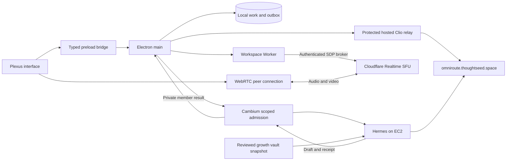

# Plexus feature guide, Phloem mapping and calling status

Reviewed October 24, 2026. Candidate source package: 0.7.14; public release: 0.7.13. This guide distinguishes deployed backend proof from installed employee/device acceptance.

## Current status

| Area | Verified result | Still required |
| --- | --- | --- |
| Feature review | The inventory below covers 20 product surfaces and their source owners. | External integrations retain their individual authority and acceptance requirements. |
| Teammate media broker | Approved Labs Worker version `dd04f3dc-7cef-42f1-a376-20a0f018c2fe` is live at 100%. Two authenticated browser peers published and received generated audio/video. | Distinct installed teammate identities, physical microphone/camera permissions and real-device interaction. |
| Media reception | Both peers connected. Over 8.921 seconds, A received another 127,337 bytes and decoded 108 video frames; B received another 132,703 bytes and decoded 107 frames. Both remote audio streams decoded to non-zero signal. | This probe used one admin identity and synthetic streams; it does not establish the installed two-member journey. |
| Cleanup | Both retained leave requests were acknowledged after the cleanup repair. A separate read-only D1 check found four probe participants `left` and eight tracks `closed`. | Installed-device leave, mute/rejoin and failure recovery acceptance. |
| Desktop lifecycle | Candidate `d920616` includes the shared-Access callback repair, presence/media lifecycle, nonfatal API-port conflicts, encrypted credential retention, account-transition fencing and OTA retry/downgrade fixes. Base full local release pipeline passed897 tests; callback repair passes50 focused auth/DB tests and native before/after probes. | Corrected normal-ID0.7.14 is signed/notarized and installed; owner sign-in and encrypted credential/actor persistence pass. Visible reopen confirmation and actual OTA acceptance remain open. |
| Hosted Phloem | Relay source `09b3369` is deployed. Authenticated hosted catalog returns 15 mapped lanes; a substantive hosted SSE response passed. | Installed employee Clio interaction and independently supported resolved-provider attribution. |
| Public Clio route | The approved tunnel/DNS and Access changes are deployed and read back; authenticated health/catalog requests pass. | Fresh installed employee sign-in and content-bearing native Clio turn. |
| Scoped growth handoff | Approved admin-self request generated a durable draft from reviewed vault context. Worker `15622021` acknowledged its receipt; original attempt and draft digest are unchanged. | Ordinary-employee native Clio confirmation and returned draft display; admin-self backend proof does not close that journey. |

The current acceptance ledger is [ISA.md](../ISA.md). [Structured live media evidence](evidence/2026-10-23-live-two-peer-media.json) preserves the measurements and the initial cleanup failure followed by successful reconciliation. Earlier observations, test counts and deployment versions are preserved in [rollout history](PLEXUS_PHLOEM_CALLING_REVIEW_HISTORY.md).

## How the application fits together

Plexus is the desktop workspace for a member's projects, focus sessions, evidence, assistant conversations and co-working. React renders the interface. A typed preload bridge connects it to Electron main, which owns local SQLite, OS integration, credentials and authenticated API requests. The Workspace Worker owns canonical membership, projects, room presence and the media broker.

Clio is the assistant inside Plexus. Its relay checks Access and membership, then translates the selected compatibility lane into a hosted Phloem combo. Audio/video calls use a separate WebRTC connection through Cloudflare Realtime. Choosing an AI model does not establish a call.

## Feature inventory and source ownership

These are implemented surfaces/contracts, not a claim that every external
integration is currently operational for the signed-in user.

| Feature | What the user can understand/do | Primary source | External boundary |
| --- | --- | --- | --- |
| Sign-in and onboarding | Establish member identity, permissions and workspace setup | `Login.tsx`, `Onboarding.tsx`, `main/teamforge.ts` | Cloudflare Access and Worker session |
| Focus timer and recovery | Track work, pause/resume and recover an interrupted session | `Timer.tsx`, `main/timer-session.ts`, `main/idle.ts` | Local persistence; later Worker sync |
| Work ledger and evidence | Review time entries, charts and proof coverage | `TimeEntryList.tsx`, `TimeChart.tsx`, `main/evidence.ts`, `main/proof-report.ts` | Evidence identity and sync receipts |
| Canonical projects | Select verified projects and associate GitHub repositories | `ProjectManager.tsx`, `main/teamforge.ts`, `main/github-repository-binding-lock.ts` | Worker project authority and GitHub grants |
| Reports, reviews and growth | Inspect work summaries, periodic review and KPI signals | `Reports.tsx`, `GrowthOverviewPanel.tsx`, `main/review-cycle.ts`, `main/growth-overview.ts` | Worker summary and reporting delivery |
| Export | Prepare work data output | `ExportPanel.tsx` | Exported file contents/permissions |
| Backups and restore | List local backups and restore persisted work | `BackupPanel.tsx`, `main/backup.ts` | Local filesystem and restore confirmation |
| Clio conversation | Stream assistant responses with bounded work context and model selection | `AssistantPanel.tsx`, `main/assistant-runtime.ts`, `main/assistant-context.ts`, `main/assistant-omniroute.ts` | Authenticated relay and provider result |
| Assistant actions | Review/confirm/cancel write-capable tool intents | `AssistantActionConfirmModal.tsx`, `main/assistant-tools.ts`, `main/assistant-policy.ts`, `main/assistant-permissions.ts` | Action-specific authority and expiry |
| AI session activity | Discover/group local AI sessions; accept/dismiss work candidates | `AgentSessionsPanel.tsx`, `AgentActivityHub.tsx`, `main/agent-sessions.ts` | Local scanner provenance; accepting creates work data |
| Organization growth drafting | Confirm a bounded internal brief and retrieve its draft with source references | `AssistantGrowthRequest.tsx`, `main/assistant-tools.ts`, `main/teamforge.ts` | Cambium admission, Hermes execution and verified receipt; publishing requires separate authority |
| Member reporting | Queue daily evidence, retry and hand off to Hermes | `main/assistant-daily.ts`, `main/thoughtseed-bridge.ts` | Bridge acknowledgement differs from final delivery |
| Co-working presence | See floor/lounge and focused project zones | `CoWorkingPanel.tsx`, `main/coworking-presence-controller.ts`, `main/coworking-presence.ts` | Authorized presence lifecycle and Worker readback |
| Audio, camera and screen controls | Request device access and publish/subscribe tracks in a project call | `renderer/lib/useRealtimeMedia.ts`, `renderer/lib/RealtimeSession.ts`, `coworking/DeviceControls.tsx`, `coworking/MediaDock.tsx`, `coworking/StudioStage.tsx` | SFU session/SDP negotiation and remote MediaStreams |
| Meeting closeout | Save manual notes, decisions/action items and linked work | `coworking/CoWorkingCloseoutModal.tsx`, `main/teamforge.ts` | Queued closeout is not downstream dispatch proof |
| Recording/transcription | Reserved/proposed recording contracts exist | `shared/types.ts`, `preload/preload.ts`, realtime contract | Main recording handlers and capture/storage path absent; not ready |
| Settings/profile | Manage preferences, identity and assistant settings | `Settings.tsx`, `PreferencesPanel.tsx`, `ProfileCard.tsx`, `IdentityPanel.tsx` | Per-member persistence and identity grants |
| Updates | Check, download and explicitly consent to installation/restart | `UpdatePrompt.tsx`, `main/updates.ts` | Signed/notarized published release plus installed proof |
| Administration/diagnostics | Inspect project/member operational evidence | `AdminDiagnosticsPanel.tsx`, `AdminProofCockpitPanel.tsx`, `AdminDemoPanel.tsx` | Admin authorization and diagnostic scope |
| Desktop integration | Tray, shortcuts, window modes, idle/device permissions | `main/tray.ts`, `main/shortcuts.ts`, `main/window-mode.ts`, `main/media-authorization.ts` | OS permissions and installed bundle |

Component names in this table are under `src/renderer/components/` unless a
`main/`, `preload/`, `shared/` or `renderer/lib/` prefix is shown; those prefixes
are relative to `src/`. Historical `teamforge` filenames are compatibility
implementation names. They do not create a second authority for project identity.

## A practical walkthrough

1. Sign in with your workspace identity. Confirm your projects and role before starting work.
2. Select a canonical project. Start a focus session, describe the work, pause/resume as needed and review the resulting ledger and evidence.
3. Use reports and reviews to inspect work signals. Exports and backups have separate file and restore boundaries.
4. Open Clio for contextual assistant work. Review write-capable action confirmations. The hosted route is deployed; native employee acceptance remains open. For organization growth drafting, review the brief, role and sources before confirming; the returned draft does not authorize publication.
5. Open Co-working and join the lounge or a permitted project room. Joining establishes presence and keeps local devices off.
6. Enable microphone, camera or screen sharing explicitly. The repaired client obtains permission and capture first, then allocates a media session and publishes immediately. Receiving an advertised teammate publication can allocate a receiving connection without capturing your devices.
7. Teammates in the same authorized call subscribe through the Worker. A successful provider offer/answer exchange is followed by actual remote media playback; room membership alone is not media proof.
8. On leave, capture and remote playback stop immediately. The Worker reconciles owned provider resources, and the client closes its peer in `finally`. Unknown cleanup outcomes remain visible for retry.
9. Save meeting notes, decisions and action items through meeting closeout when useful. Recording and automatic transcription remain incomplete contracts, with capture/storage implementation and consent acceptance still required.

## Clio to hosted Phloem mapping

The packaged desktop targets `https://clio-relay.thoughtseed.space`. The deployed relay pins `https://omniroute.thoughtseed.space` and uses mapping version `phloem-lanes.v1`. Provider credentials stay on the server. The old IDs below are existing desktop compatibility IDs; new routing dispatches use canonical `noesis-*` combos.

| Existing desktop ID | Hosted Phloem combo |
| --- | --- |
| `te-fast` | `noesis-fast` |
| `te-build` | `noesis-build` |
| `te-reason` | `noesis-observe` |
| `te-validate` | `noesis-verify` |
| `te-plan` | `noesis-plan` |
| `te-dispatch-paid` | `noesis-execute` |
| `te-creative` | `noesis-creative` |
| `te-write` | `noesis-write` |
| `te-write-critique` | `noesis-write-critique` |
| `te-write-research` | `noesis-research` |
| `te-write-media` | `noesis-media` |
| `te-swarm-s` | `noesis-swarm` |
| `te-review` | `noesis-review` |
| `te-free-burst` | `noesis-free-burst` |
| `temperance-coding` | `noesis-build` |

A requested combo is a routing policy, not proof of the resolved provider/account. Catalog availability and a response model field also do not independently establish provider attribution. The settings UI preserves unknown health until supported by current evidence.

The local source relay probe used explicit synthetic identity/member fixtures and a real hosted upstream: 15 mapped catalog lanes, completed SSE, and the expected content marker. The deployed relay also passed authenticated hosted catalog and substantive-stream checks. Installed Clio still needs the ordinary-employee Access/member journey; server/browser proof is separate.

## Calling repairs and evidence

The broker now allocates real provider sessions, publishes/subscribes tracks, completes renegotiation and keeps provider IDs server-owned. It preserves room/member/project scope and serializes media mutations. The client rejects metadata-only success, maps received mids to publications, renders actual camera/screen streams, removes stale subscriptions and stops capture after failed or interrupted negotiation.

Live testing exposed two runtime boundaries missed by mocked tests:

- Workers rejects `redirect: "error"` before a request is sent. The broker uses `manual` and rejects non-success responses, preserving the pinned origin and redirect boundary. An actual workerd probe with compatibility date `2026-04-09` reproduces this difference. See [Cloudflare Request documentation](https://developers.cloudflare.com/workers/runtime-apis/request/).
- Cleanup must distinguish an already-gone owned session or already-closed track from an unresolved provider error. The broker accepts only documented terminal outcomes and complete matching close results. Unknown/missing results stay pending. See [Cloudflare SFU error codes](https://developers.cloudflare.com/realtime/sfu/observability/error-codes/).

The media Worker checkpoint passed TypeScript and 213 tests. The current desktop release pipeline passed 897 tests: 602 assistant, 185 co-working, 10 identity, 74 renderer, 7 documentation and 19 release operations. These source checks support the specific implementation; they do not replace installed-device acceptance.

## Source review and remaining work

| Component | Review |
| --- | --- |
| Plexus desktop and guide | [PR 175](https://github.com/Sheshiyer/plexus-ts/pull/175) |
| Workspace Worker media broker | [PR 104](https://github.com/Sheshiyer/team-forge-ts/pull/104) |
| Hosted Clio relay | [PR 165](https://github.com/Sheshiyer/hermes-aws-ts/pull/165) |

The original root work remains preserved. These isolated source candidates and the approved live Worker deployment have separate evidence. The protected public relay and scoped backend are deployed. The corrected signed/notarized0.7.14 app is installed and real owner sign-in passes. Corrected local ZIP/DMG artifacts pass security and hash checks. Public release and complete ordinary-employee/device acceptance remain open.

To finish the original goal:

1. Accept the matching packaged client and run two distinct signed-in teammate clients with physical devices. Verify received audio/video, mute/rejoin, permission denial, scoped access and stopped capture on leave.
2. Confirm the visible same-workspace reopen in the corrected installed0.7.14 client, then verify a real signed prior-version OTA transition using the reviewed isolated canary. Corrected local installers are ready; external test publication requires the scoped credential and exact artifact approval.
3. In that installed client, verify ordinary-employee Access login, authenticated catalog, substantive Clio stream, explicit growth confirmation and the returned draft. Preserve the distinction between requested combo and proved provider attribution.

Worker rollback version `44c06546-61c2-48bc-bedb-d1149409f12c` remains recorded in the [Worker staging receipt](https://github.com/Sheshiyer/team-forge-ts/blob/codex/plexus-sfu-broker-20261023/docs/PLEXUS_CALLING_LABS_STAGING_20261023.md). Do not overwrite live Labs settings with the legacy repository configuration.

## Persistent acceptance bundle receipt

The earlier temporary artifact and probe handle disappeared before a successful renderer receipt was recovered, so that attempt remains unaccepted. A fresh standard-name bundle was built at `release/calling-acceptance-20261023/mac-arm64/Plexus.app` under this isolated worktree, with acceptance app ID `space.thoughtseed.plexus.callingacceptance`. It is an ad-hoc local build without notarization or publication. The repository's `smoke-packaged-renderer.mjs --app ...` passed after copying the app to an isolated temporary directory; the renderer loaded from `app.asar`. The smoke process and its temporary copy were cleaned up by the script.

Wrangler refreshed the named Labs profile and independently confirmed version `dd04f3dc-7cef-42f1-a376-20a0f018c2fe` remains at 100% traffic.

The persistent bundle also passed `smoke-packaged-main.mjs`: its packaged main process booted from `app.asar` with a complete module graph. Neither startup check establishes physical device permissions or a signed release.

## Current scoped backend closure

The original approved admin-self execution is `acked`; canonical D1 `delivered=1` at `2026-10-24T00:48:52.299Z`. The private result remains the same 1,211-character draft on attempt 1. The separate 768-dimensional receipt index uses Cloudflare Workers AI; the original 1024-dimensional semantic index is unchanged. No new-space semantic recall, draft regeneration, external publication or global execution is included. See the [pinned Cambium production receipt](https://github.com/Sheshiyer/cambium/blob/a8ecb18/docs/evidence/2026-10-24-hermes-receipts-768-production.json) and [employee workflow](EMPLOYEE_GROWTH_WORKFLOW.md).
