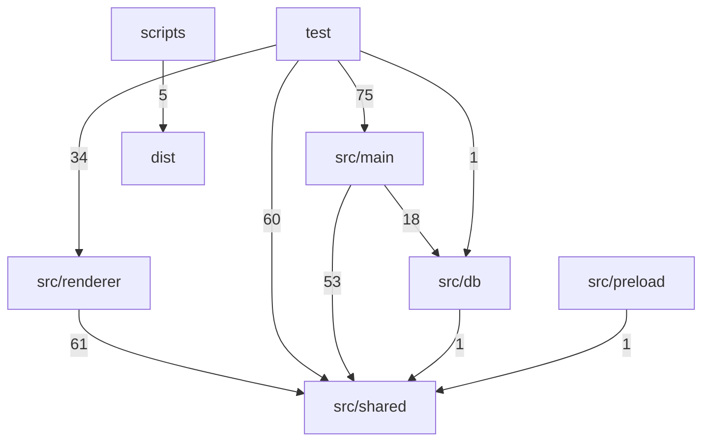

# Dependency Graph

> Auto-generated by `ArchitectureAssetsSync.hook.ts`. Last refreshed: 2026-10-23T23:56:32.951Z
> Scanned 348 source files. Edges aggregate to top-level directories (or `src/<name>`).

## Module graph

## Edge counts

| From | To | Imports |
|---|---|---|
| `test` | `src/main` | 75 |
| `src/renderer` | `src/shared` | 61 |
| `test` | `src/shared` | 60 |
| `src/main` | `src/shared` | 53 |
| `test` | `src/renderer` | 34 |
| `src/main` | `src/db` | 18 |
| `scripts` | `dist` | 5 |
| `src/db` | `src/shared` | 1 |
| `src/preload` | `src/shared` | 1 |
| `test` | `src/db` | 1 |